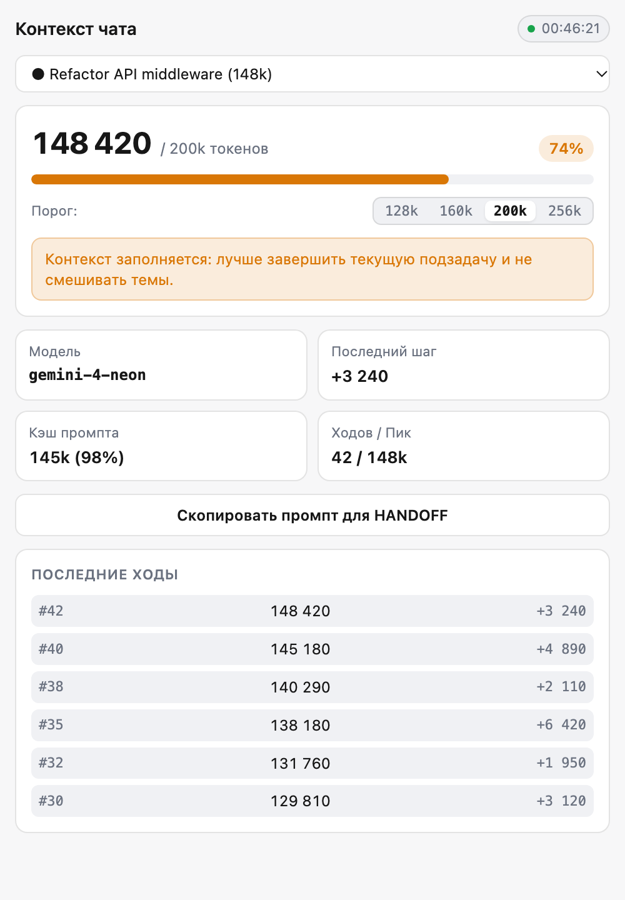
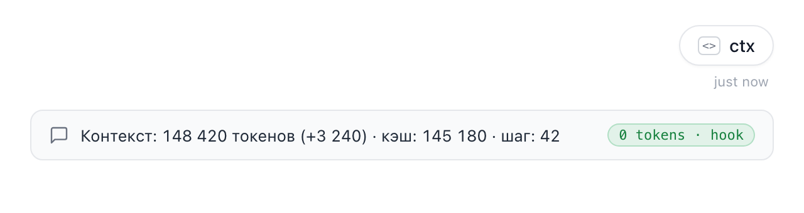

# Chat Tokens & Context Monitor for Antigravity 2.0

[](https://github.com/vladsboev-web/chat_tokens/releases)
[](LICENSE)

All-in-one, zero-dependency plugin for **Google Antigravity 2.0** combining:
1. **Context Monitor** — a live native Sidecar side panel in the right-hand Auxiliary Pane.
2. **Instant `/ctx` & `/чат` commands** — a 0-token `PreInvocation` hook that prints the exact current chat token count without calling the LLM.

---

## Screenshots / Скриншоты

<p align="center">
  
</p>

<p align="center">
  
</p>

---

## Features / Возможности

- **Live Sidecar Panel (`Context Monitor`)**
  - **Context & Stats tabs**: monitor live context window usage in the current chat alongside aggregated local usage stats for the current chat and across all chats (`24h / 7d`).
  - **Selectable threshold presets** (`128k`, `160k`, `200k`, `256k`, `1M`) saved per user in `localStorage`.
  - **Estimated Context Breakdown**: visual breakdown by category (*System & rules*, *Tools & files*, *Assistant & thinking*, *User messages*) plus total output and top tool call summary.
  - **Messages / Steps toggle** in Recent activity with mode-aware metrics: *Primary model* (with `+N` other models indicator), *Last message / step delta*, *Cache hit ratio*, and *Messages / Steps vs. Peak*.
  - **Compaction detection** — detects automatic context compaction via `CHECKPOINT` transcript events and drop heuristics, showing `⚡ compacted` badges in history and session alerts.
  - **Automatic RU / EN localization** based on system locale, plus a manual **`RU / EN` toggle** in the panel header.
  - Automatic light/dark theme sync with Antigravity 2.0.
  - **One-click `HANDOFF.md` prompt copy** — wrap up long sessions cleanly before auto-compaction erases fine-grained constraints.
  - Switch between the 10 most recent conversations right from the panel.
- **Instant 0-Token Slash Command (`/ctx`, `/чат`, `/chat`, `/tokens`)**
  - Both `/ctx` and `/чат` are registered in the `/` autocomplete menu (`skills/ctx/SKILL.md` and `skills/чат/SKILL.md`).
  - Intercepted locally by a `PreInvocation` hook (`./scripts/chat_tokens_hook.py`) before any model request is sent (**0 LLM tokens, 0 quota spent**).
  - Outputs via `errorMessage.userMessage` so the token count (including compaction count when present) is guaranteed visible in both `Default` and `Verbose` conversation step modes without ever being sent to the model.
- **100% Local & Zero Dependencies**
  - Uses only Node.js built-ins + Antigravity's built-in `sidecar_sdk`, and Python 3 standard library.
  - Read-only access to `~/.gemini/antigravity/brain/<conversationId>/.system_generated/logs/` (`transcript_full.jsonl` / `transcript.jsonl`).

---

## Requirements / Требования

- **Google Antigravity 2.0** (Desktop app)
- **Node.js** (bundled or installed on `PATH`)
- **Python 3** (for the `/ctx` / `/чат` hook)

---

## Installation / Установка

### Option 1: Via Antigravity CLI (`agy`)
```bash
agy plugin install https://github.com/vladsboev-web/chat_tokens
```

### Option 2: Manual / Antigravity 2.0 Desktop (`git clone`)
Clone (or copy) this repository into `~/.gemini/config/plugins/chat_tokens`:

```bash
git clone https://github.com/vladsboev-web/chat_tokens.git ~/.gemini/config/plugins/chat_tokens
```

Then **restart Antigravity 2.0**.

> **Note:** If you previously installed standalone `hooks.json`, `scripts/chat_tokens_hook.py`, `skills/ctx`, or `plugins/context_monitor`, remove those duplicates so the single unified plugin handles everything without hook conflicts.

---

## Usage / Использование

### 1. Sidecar Panel (`Context Monitor`)
Open the right-hand Auxiliary Pane and switch to the **Context** tab (or ask the agent to surface the `[Context Monitor](sidecar://chat_tokens/context_monitor/)` pill).

### 2. Slash Commands in Chat
Send any of the following as a standalone message:
- `/ctx` (available in the `/` autocomplete menu via `skills/ctx/SKILL.md`)
- `/чат`
- `/chat`
- `/tokens`

Example output:
```text
Контекст: 128 991 токенов (+2 850) · кэш: 126 141 · шаг: 109
```

> **Note on display:** Because Antigravity 2.x hides empty `systemMessage` rows in chat, the hook injects the line via `errorMessage.userMessage` — the UI shows an `Error` prefix for this step type, while guaranteeing visibility in both `Default` and `Verbose` modes with 0 tokens sent to the model.

---

## Repository Layout / Структура проекта

```text
chat_tokens/
├── plugin.json                        # Plugin manifest
├── hooks.json                         # PreInvocation hook registration
├── scripts/
│   └── chat_tokens_hook.py            # 0-token local hook (/ctx, /чат, /chat, /tokens)
├── skills/
│   ├── ctx/
│   │   └── SKILL.md                   # Registers /ctx in the '/' autocomplete menu
│   └── чат/
│       └── SKILL.md                   # Registers /чат in the '/' autocomplete menu
└── sidecars/
    └── context_monitor/
        ├── package.json               # ESM module marker
        ├── sidecar.json               # Auxiliary Pane UI registration
        ├── main.mjs                   # Read-only transcript HTTP server
        └── index.html                 # Sidecar frontend UI
```

---

## Privacy & Security / Приватность

- No external network requests, no telemetry, no API calls.
- All files are read-only against local Antigravity logs (`~/.gemini/antigravity/brain/`).

---

## Authors / Авторы

- **vladsboev-web** — idea, architecture, and product direction
- **Antigravity (Google DeepMind)** — co-author & implementation

---

## License

[MIT](LICENSE)
